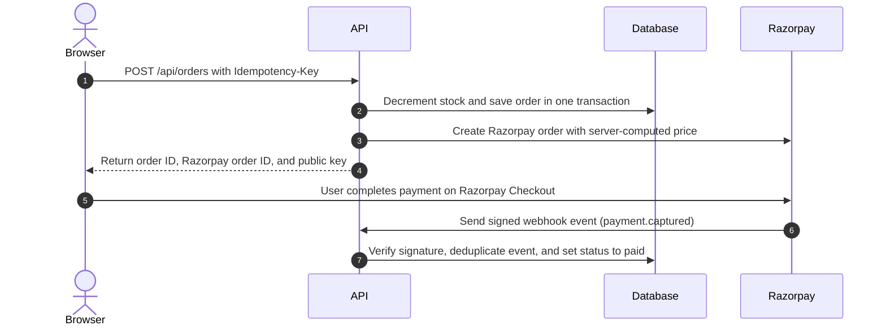

# CartAPI — Orders & Payments Backend with Razorpay (2026)

[](https://github.com/deoreparth700-design/Cart-API/actions/workflows/tests.yml)
## 🌐 Live Demo

**[Open the CartAPI storefront ↗](https://cart-api-m4g4.onrender.com/static/index.html)**

The storefront uses Razorpay **test mode**. Orders and payment status depend on the backend and a valid signed webhook; only the webhook can mark an order as paid.


CartAPI is an orders and payments backend service that manages catalog stock, creates Razorpay test-mode payment orders, and processes signed webhooks. An incoming payment webhook is the only mechanism permitted to transition an order status to paid. The application is built with Python, FastAPI, PostgreSQL on Neon, plain SQL queries executed through psycopg v3, and Razorpay test mode.

## Testing Razorpay Payments

CartAPI integrates Razorpay in **Test Mode** to safely simulate order creation, checkout flows, and webhook callbacks without transferring real money or requiring real banking credentials.

### Official Test Card Details

| Field | Value | Notes |
| :--- | :--- | :--- |
| **Payment Provider** | Razorpay | Test Mode simulation |
| **Card Network** | Visa (Domestic) | Official Razorpay test card |
| **Card Number** | `4100 2800 0000 1007` | Can be copied with one click on the storefront |
| **Expiry Date** | Any future date | e.g., `12/28` |
| **CVV** | Any random 3-digit CVV | e.g., `123` |
| **Documentation** | [Razorpay Test Card Details](https://razorpay.com/docs/payments/payments/test-card-details/) | Official Razorpay test card documentation |

> **⚠️ Notice:** This card is strictly for **Razorpay Test Mode**. Never enter your real personal credit/debit card details for this demo, and never use test card details with Live Mode credentials.

### Step-by-Step Checkout Testing on the Live Storefront

1. **Open the Storefront:** Navigate to the live demo at **[CartAPI Storefront](https://cart-api-m4g4.onrender.com/static/index.html)** (or `http://localhost:8000/static/index.html` locally).
2. **Copy Test Card Number:** In the **Test Payment Details** section, click the **Copy Card Number** button to copy `4100280000001007` to your clipboard.
3. **Add Items to Cart:** Browse the catalog (e.g. Notebook, Pen, Ruler) and add items to your cart.
4. **Proceed to Checkout:** Open the cart drawer and click **Proceed to Pay**. CartAPI will atomically reserve stock and initialize a Razorpay payment order.
5. **Select Card in Checkout:** When the Razorpay Checkout popup appears, choose **Card** as the payment method.
6. **Enter Test Credentials:** Paste the copied card number `4100 2800 0000 1007`, enter any future expiry date (e.g. `12/28`), and any random CVV (e.g. `123`).
7. **Simulate Payment Authorization:** Complete the simulated flow following on-screen prompts. If an OTP prompt appears, follow Razorpay's Test Mode instructions (e.g., click "Success" or enter the test OTP). Never enter a real bank OTP.
8. **Verify Server-Side Status:** The checkout popup closing or reporting success in the browser does not by itself mark an order as paid in CartAPI. An order transitions to `paid` strictly when Razorpay delivers a cryptographically verified `payment.captured` webhook. You can confirm the persisted status via `GET /api/orders/{order_id}`.

## Payment Flow



Only the webhook can set paid.

## Setup

### Windows PowerShell

1. Clone the repository:
   ```powershell
   git clone https://github.com/deoreparth700-design/Cart-API.git
   cd "Cart API"
   ```
2. Create and activate a virtual environment:
   ```powershell
   python -m venv .venv
   .\.venv\Scripts\Activate.ps1
   ```
3. Install dependencies:
   ```powershell
   pip install -r requirements.txt
   ```
4. Configure environment variables:
   ```powershell
   Copy-Item .env.example .env
   ```
   Fill in the required configuration in `.env`.
5. Initialize the database:
   Create a database on Neon. Open the Neon SQL Editor and execute `db/schema.sql`, then execute `db/seed.sql`.
6. Start the development server:
   ```powershell
   uvicorn app.main:app --reload --port 8000
   ```
7. Open interactive documentation:
   Navigate to `http://localhost:8000/docs` in your browser.

> Note for macOS/Linux: Activate the virtual environment with `source .venv/bin/activate` and copy the environment template using `cp .env.example .env`.

### Docker (FastAPI + PostgreSQL)

**Prerequisite:** Install Docker Desktop and make sure it is running.

1. Build the API image and start FastAPI with its local PostgreSQL database:

   ```bash
   docker compose up --build -d db api
   ```

   On first startup, PostgreSQL initializes the schema and seed data from `db/schema.sql` and `db/seed.sql`. The named database volume keeps local data across container restarts and ordinary `docker compose down` / `up` cycles.

2. Verify the application:

   - Health check: [http://localhost:8000/health](http://localhost:8000/health) — expected response: `{"status":"ok"}`
   - Interactive API docs: [http://localhost:8000/docs](http://localhost:8000/docs)
   - Product catalog: [http://localhost:8000/api/products](http://localhost:8000/api/products)

   If host port `8000` is already in use, select another host port in PowerShell:

   ```powershell
   $env:PORT = "8001"
   docker compose up --build -d db api
   ```

   Then open the API at `http://localhost:8001`.

3. Run the full test suite in Docker:

   ```bash
   docker compose run --rm test
   ```

   The test runner uses the separate local PostgreSQL service `db_test`, not the application database `db` or your Neon database. Razorpay API calls are mocked by the automated tests; the test run does not make real payments.

**Configuration note:** The Compose configuration uses placeholder JWT and Razorpay values, with `DEMO_MODE=false`. The API health check and automated tests can run with this setup, but testing a real Razorpay test-mode checkout requires valid test credentials and a `JWT_SECRET` that matches the service issuing your tokens. Configure these locally and never commit real secrets.

**Stopping the environment:**

- `docker compose stop` stops running containers but keeps them.
- `docker compose down` removes containers and the Compose network while preserving named database volumes.
- **Warning:** `docker compose down -v` also deletes the named database volumes and the local database data stored in them.

## Environment Variables

| Variable | Description | Where to Get |
| :--- | :--- | :--- |
| `DATABASE_URL` | PostgreSQL connection string for the main database. | Neon Console dashboard under connection details. |
| `JWT_SECRET` | Secret key used to verify incoming JWT bearer tokens. | Issued by your separate authentication service. |
| `JWT_ALGORITHM` | Cryptographic algorithm used to decode JWT tokens (e.g. HS256). | Configured to match your authentication service. |
| `RAZORPAY_KEY_ID` | Public key identifier for Razorpay test mode. | Razorpay Dashboard under Settings > API Keys. |
| `RAZORPAY_KEY_SECRET` | Secret key for Razorpay test mode API authentication. | Razorpay Dashboard under Settings > API Keys. |
| `RAZORPAY_WEBHOOK_SECRET` | Secret key used to verify HMAC-SHA256 webhook signatures. | Configured when creating the webhook in Razorpay Dashboard. |
| `TEST_DATABASE_URL` | Connection string for a separate, empty test database with `db/schema.sql` applied. | Created as an isolated database or branch on Neon. |
| `DEMO_MODE` | Turns on `/api/demo-token` for the storefront demo (default: false; must be true for the storefront checkout to work). | Set to `true` locally or in demo environments, leave `false` in production. |

## API Endpoints

| Method | Path | Login Needed | Headers | Success | Errors |
| :--- | :--- | :--- | :--- | :--- | :--- |
| `GET` | `/health` | No | None | `200` | None |
| `GET` | `/static/checkout_test.html` | No | None (reads URL query parameters) | `200` | `404` |
| `GET` | `/api/products` | No | None | `200` | `500` |
| `POST` | `/api/orders` | Yes | `Authorization: Bearer <token>`<br>`Idempotency-Key: <string>`<br>`Content-Type: application/json` | `201` (new)<br>`200` (replayed) | `400`, `401`, `404`, `409`, `502` |
| `GET` | `/api/orders/{id}` | Yes | `Authorization: Bearer <token>` | `200` | `401`, `404` |
| `POST` | `/api/webhooks/razorpay` | No (HMAC signed) | `X-Razorpay-Signature: <string>`<br>`X-Razorpay-Event-Id: <string>`<br>`Content-Type: application/json` | `200` | `400`, `401` |

## Try a Payment End to End

1. Expose your local server using ngrok:
   ```bash
   ngrok http 8000
   ```
2. Configure your webhook in the Razorpay Dashboard:
   - Webhook URL: `https://<your-ngrok-subdomain>.ngrok-free.app/api/webhooks/razorpay`
   - Active Events: select `payment.captured` and `payment.failed`.
   - Secret: enter a secret string and save it to `RAZORPAY_WEBHOOK_SECRET` in `.env`.
   - Note: `RAZORPAY_WEBHOOK_SECRET` is completely separate from `RAZORPAY_KEY_SECRET`.
3. Create an order:
   Send a `POST /api/orders` request with a valid JWT and an `Idempotency-Key` header. Receive `id`, `total_paise`, `razorpay_order_id`, and `razorpay_key_id`.
4. Open the test checkout page in your browser:
   ```text
   http://localhost:8000/static/checkout_test.html?order_id=<razorpay_order_id>&amount=<total_paise>&key=<razorpay_key_id>
   ```
5. Complete payment:
   Use official test card `4100 2800 0000 1007` with any future expiry date and any random 3-digit CVV. Follow Razorpay's on-screen Test Mode interface instructions.
6. Expected result:
   Razorpay delivers a signed webhook to `/api/webhooks/razorpay`. The API validates the signature and marks the order status as `paid` in the database.

### Testing Webhooks Locally via CLI

The helper script `scripts/sign_webhook.py` sends signed payloads from a JSON file:

1. Normal delivery:
   ```bash
   python scripts/sign_webhook.py payload.json
   ```
   Expected output: `Status Code: 200` with response body `{"status": "processed", ...}`.
2. Duplicate event replay:
   ```bash
   python scripts/sign_webhook.py payload.json --event-id evt_test_100
   ```
   Run the command once: returns `Status Code: 200` with `status: processed`. Run the exact same command a second time: returns `Status Code: 200` with `status: ignored` and `reason: duplicate_event`.
3. Tampered payload simulation:
   ```bash
   python scripts/sign_webhook.py payload.json --tamper
   ```
   Expected output: `Status Code: 401` with detail `Invalid or missing webhook signature`.

## Tests

When running `python -m pytest` locally, tests use the dedicated test database configured by `TEST_DATABASE_URL` in `.env`; never point this variable at production data. The Docker test command uses the separate local PostgreSQL service `db_test` instead, so Docker tests do not require a remote Neon test database. Automated tests mock calls to the Razorpay API.

Run the test suite locally:
```bash
python -m pytest
```

Run the test suite in Docker (isolated `db_test` PostgreSQL service):
```bash
docker compose run --rm test
```

### Test Files

- `tests/test_edge_cases.py`
  Tests edge cases such as static HTML delivery and malformed JSON payloads. Verifies that unexpected errors roll back transactions and non-idempotency unique errors re-raise.
- `tests/test_order_idempotency.py`
  Tests header validation, blank keys, and repeated identical keys returning 201 then 200 with unchanged stock. Verifies concurrent race safety where simultaneous threads with the same key produce exactly one order.
- `tests/test_order_transaction.py`
  Tests ACID transaction semantics, multi-item stock deductions, and server-side price computation. Verifies that catalog stock shortages roll back cleanly and prevent partial order creation.
- `tests/test_signature.py`
  Tests HMAC-SHA256 webhook signature verification against exact raw request bytes. Verifies that forged signatures, altered body payloads, or wrong secrets fail with HTTP 401 without database changes.
- `tests/test_webhook_idempotency.py`
  Tests duplicate webhook events, payment amount verification, and out-of-order deliveries. Verifies that `payment.failed` preserves orders for retry without overselling stock and gateway failures roll back.

### How I Checked the Tests Really Protect the Code

I removed three guards on purpose and watched what happened, then restored them:

1. `AND status = 'created'`: Removed from the update in `mark_order_paid`. A failed order became paid on a retry event, causing test assertion failures.
2. `AND stock >= %s`: Removed from `decrement_product_stock`. A purchase exceeding inventory threw a raw database CHECK constraint error instead of returning a clean HTTP 409 Conflict.
3. `Idempotency pre-check`: Bypassed the initial `get_order_by_idempotency_key` pre-check. The code remained safe because the database `UNIQUE(user_id, idempotency_key)` constraint caught the duplicate and resolved it cleanly.

## Design Decisions

- **Money as integer paise:** Avoids floating-point rounding errors common in monetary calculations. Razorpay also expects all transaction amounts in integer paise (₹1 = 100 paise).
- **Server computes the price:** Client-supplied prices and totals are completely ignored. The server looks up prices directly from the catalog table inside the transaction so clients cannot manipulate amounts.
- **One transaction for stock + order and `AND stock >= qty`:** Stock decrement and order creation run in a single atomic database transaction. The `AND stock >= %s` clause ensures two concurrent buyers cannot purchase the last item, with the table `CHECK (stock >= 0)` constraint acting as a hard database backup.
- **Idempotency key = pre-check plus `UNIQUE(user_id, idempotency_key)`:** A fast select pre-check quickly replays existing orders without touching stock. If two requests race concurrently, the composite unique database constraint guarantees that exactly one succeeds and the other replays.
- **Webhook = raw-body HMAC-SHA256, constant-time compare, 401 on mismatch:** Signatures are computed using the exact unparsed request byte stream rather than re-serialized JSON. `hmac.compare_digest` prevents timing attacks, and signature mismatches immediately return HTTP 401.
- **Event IDs saved in the same transaction as the order update:** The webhook event ID is recorded in `webhook_events` within the same database transaction that marks the order as paid. If either operation fails, both roll back, ensuring duplicate webhook events are reliably detected and ignored.
- **`WHERE status = 'created'` so an order never moves backwards:** An order can only transition to paid if its current status is 'created'. This prevents out-of-order, duplicate, or stale webhook deliveries from overwriting already settled orders.
- **Paid amount compared with total_paise:** The webhook handler verifies that the `amount` field in the Razorpay payload matches `total_paise` on the order record. If a mismatch occurs, the order is not marked paid, protecting against underpayment tampering.
- **`user_id` is an integer from the "userId" claim:** Extracts the user ID directly from the `userId` claim inside the JWT token issued by the separate authentication service. Preserves the integer type without string casting to match the schema.

## Known Limits

- A failed payment leaves the order 'created' because Razorpay lets the customer retry, so unpaid orders keep their stock reserved until an expiry job exists (not built).
- If a webhook is never delivered the order stays 'created' until Razorpay retries (a reconciliation job is future work).
- Reusing a key with a different cart returns the first order.
- No refunds.
- No rate limiting.
- With DEMO_MODE on, anyone can get a 30-minute token for a fixed demo user (id 999999), place test-mode orders and use up stock; there is no rate limiting.

## Screenshots


*POST /api/orders request in Swagger UI returning order ID, Razorpay order ID, and public key.*


*Successful payment dialog completed on the static Razorpay checkout test page.*


*Captured payment and order details viewed in the Razorpay test-mode dashboard.*


*Order status updated to paid in Neon PostgreSQL following webhook delivery.*


*Full test suite passing against the isolated Neon PostgreSQL test database.*

## Project Structure

```text
Cart-API/
├── .env.example
├── .gitignore
├── README.md
├── requirements.txt
├── app/
│   ├── main.py
│   ├── core/
│   │   ├── config.py
│   │   ├── database.py
│   │   └── security.py
│   ├── repositories/
│   │   ├── order_repo.py
│   │   ├── product_repo.py
│   │   └── webhook_repo.py
│   ├── routers/
│   │   ├── orders.py
│   │   ├── products.py
│   │   └── webhooks.py
│   ├── schemas/
│   │   ├── order.py
│   │   └── product.py
│   ├── services/
│   │   ├── order_service.py
│   │   ├── razorpay_service.py
│   │   └── webhook_service.py
│   └── static/
│       └── checkout_test.html
├── db/
│   ├── schema.sql
│   └── seed.sql
├── scripts/
│   └── sign_webhook.py
└── tests/
    ├── conftest.py
    ├── test_edge_cases.py
    ├── test_order_idempotency.py
    ├── test_order_transaction.py
    ├── test_signature.py
    └── test_webhook_idempotency.py
```
