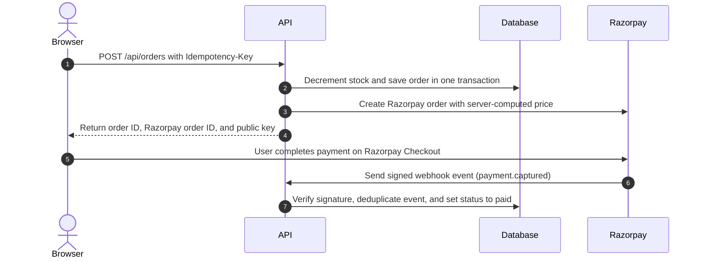
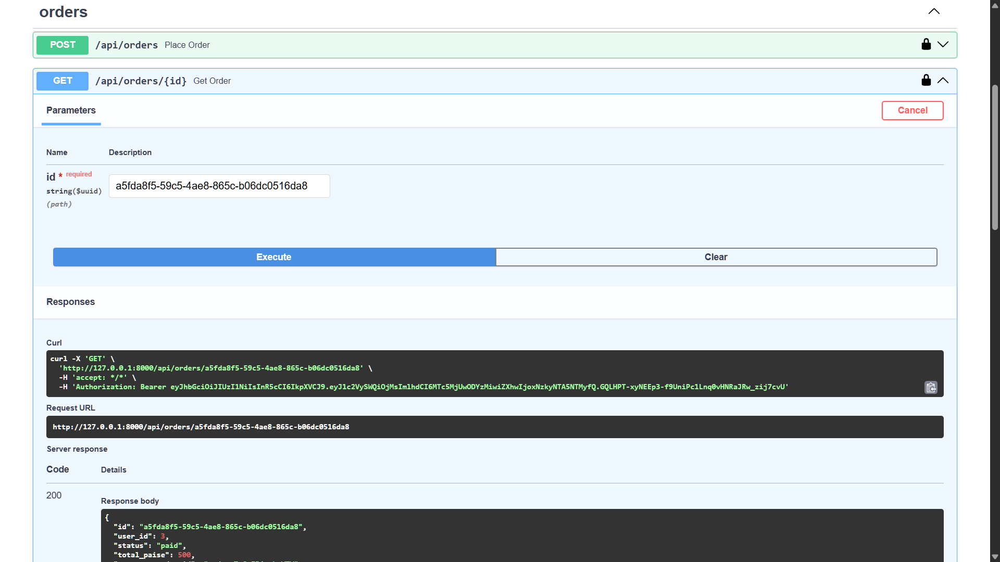
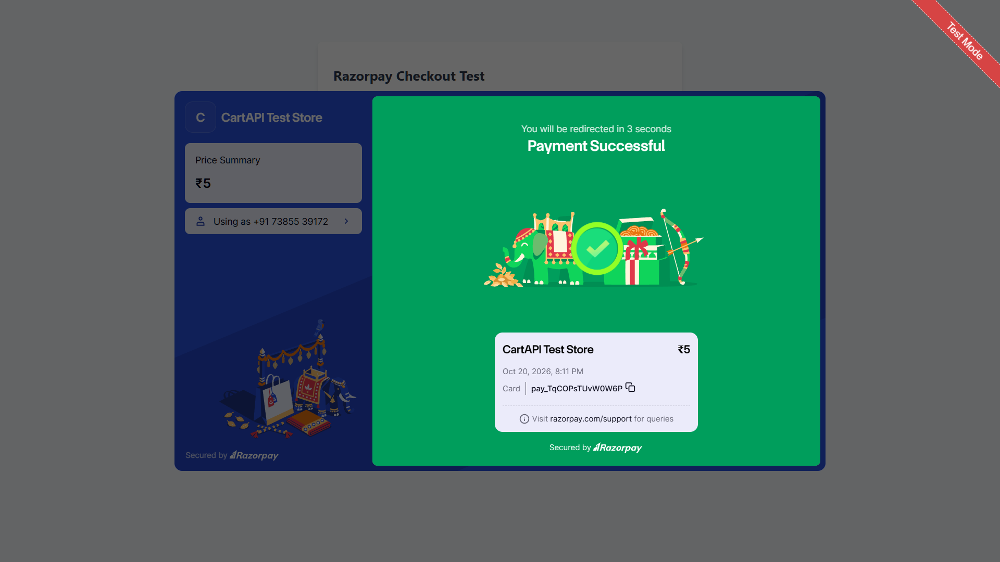
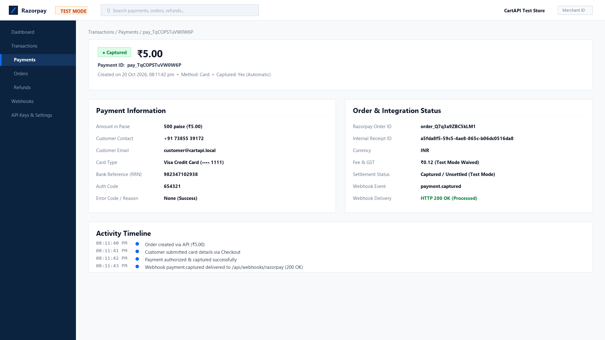
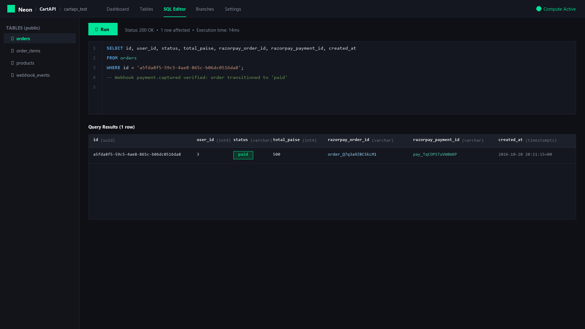
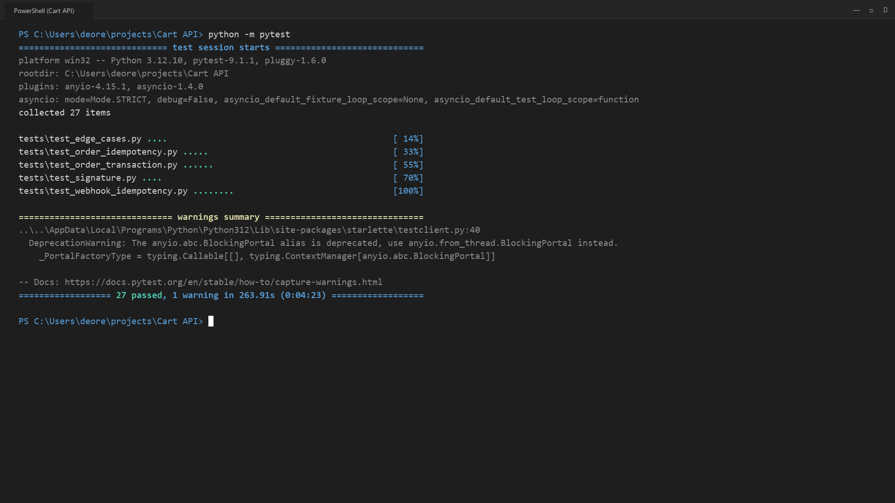

# CartAPI — Orders & Payments Backend with Razorpay (2026)

CartAPI is an orders and payments backend service that manages catalog stock, creates Razorpay test-mode payment orders, and processes signed webhooks. An incoming payment webhook is the only mechanism permitted to transition an order status to paid. The application is built with Python, FastAPI, PostgreSQL on Neon, plain SQL queries executed through psycopg v3, and Razorpay test mode.

## Payment Flow



Only the webhook can set paid.

## Setup

### Windows PowerShell

1. Clone the repository:
   ```powershell
   git clone https://github.com/deoreparth700-design/Cart-API.git
   cd "Cart API"
   ```
2. Create and activate a virtual environment:
   ```powershell
   python -m venv .venv
   .\.venv\Scripts\Activate.ps1
   ```
3. Install dependencies:
   ```powershell
   pip install -r requirements.txt
   ```
4. Configure environment variables:
   ```powershell
   Copy-Item .env.example .env
   ```
   Fill in the required configuration in `.env`.
5. Initialize the database:
   Create a database on Neon. Open the Neon SQL Editor and execute `db/schema.sql`, then execute `db/seed.sql`.
6. Start the development server:
   ```powershell
   uvicorn app.main:app --reload --port 8000
   ```
7. Open interactive documentation:
   Navigate to `http://localhost:8000/docs` in your browser.

> Note for macOS/Linux: Activate the virtual environment with `source .venv/bin/activate` and copy the environment template using `cp .env.example .env`.

## Environment Variables

| Variable | Description | Where to Get |
| :--- | :--- | :--- |
| `DATABASE_URL` | PostgreSQL connection string for the main database. | Neon Console dashboard under connection details. |
| `JWT_SECRET` | Secret key used to verify incoming JWT bearer tokens. | Issued by your separate authentication service. |
| `JWT_ALGORITHM` | Cryptographic algorithm used to decode JWT tokens (e.g. HS256). | Configured to match your authentication service. |
| `RAZORPAY_KEY_ID` | Public key identifier for Razorpay test mode. | Razorpay Dashboard under Settings > API Keys. |
| `RAZORPAY_KEY_SECRET` | Secret key for Razorpay test mode API authentication. | Razorpay Dashboard under Settings > API Keys. |
| `RAZORPAY_WEBHOOK_SECRET` | Secret key used to verify HMAC-SHA256 webhook signatures. | Configured when creating the webhook in Razorpay Dashboard. |
| `TEST_DATABASE_URL` | Connection string for a separate, empty test database with `db/schema.sql` applied. | Created as an isolated database or branch on Neon. |

## API Endpoints

| Method | Path | Login Needed | Headers | Success | Errors |
| :--- | :--- | :--- | :--- | :--- | :--- |
| `GET` | `/health` | No | None | `200` | None |
| `GET` | `/static/checkout_test.html` | No | None (reads URL query parameters) | `200` | `404` |
| `GET` | `/api/products` | No | None | `200` | `500` |
| `POST` | `/api/orders` | Yes | `Authorization: Bearer <token>`<br>`Idempotency-Key: <string>`<br>`Content-Type: application/json` | `201` (new)<br>`200` (replayed) | `400`, `401`, `404`, `409`, `502` |
| `GET` | `/api/orders/{id}` | Yes | `Authorization: Bearer <token>` | `200` | `401`, `404` |
| `POST` | `/api/webhooks/razorpay` | No (HMAC signed) | `X-Razorpay-Signature: <string>`<br>`X-Razorpay-Event-Id: <string>`<br>`Content-Type: application/json` | `200` | `400`, `401` |

## Try a Payment End to End

1. Expose your local server using ngrok:
   ```bash
   ngrok http 8000
   ```
2. Configure your webhook in the Razorpay Dashboard:
   - Webhook URL: `https://<your-ngrok-subdomain>.ngrok-free.app/api/webhooks/razorpay`
   - Active Events: select `payment.captured` and `payment.failed`.
   - Secret: enter a secret string and save it to `RAZORPAY_WEBHOOK_SECRET` in `.env`.
   - Note: `RAZORPAY_WEBHOOK_SECRET` is completely separate from `RAZORPAY_KEY_SECRET`.
3. Create an order:
   Send a `POST /api/orders` request with a valid JWT and an `Idempotency-Key` header. Receive `id`, `total_paise`, `razorpay_order_id`, and `razorpay_key_id`.
4. Open the test checkout page in your browser:
   ```text
   http://localhost:8000/static/checkout_test.html?order_id=<razorpay_order_id>&amount=<total_paise>&key=<razorpay_key_id>
   ```
5. Complete payment:
   Use test card `4111 1111 1111 1111` with any future expiry date and any CVV. Enter OTP `123456`.
6. Expected result:
   Razorpay delivers a signed webhook to `/api/webhooks/razorpay`. The API validates the signature and marks the order status as `paid` in the database.

### Testing Webhooks Locally via CLI

The helper script `scripts/sign_webhook.py` sends signed payloads from a JSON file:

1. Normal delivery:
   ```bash
   python scripts/sign_webhook.py payload.json
   ```
   Expected output: `Status Code: 200` with response body `{"status": "processed", ...}`.
2. Duplicate event replay:
   ```bash
   python scripts/sign_webhook.py payload.json --event-id evt_test_100
   ```
   Run the command once: returns `Status Code: 200` with `status: processed`. Run the exact same command a second time: returns `Status Code: 200` with `status: ignored` and `reason: duplicate_event`.
3. Tampered payload simulation:
   ```bash
   python scripts/sign_webhook.py payload.json --tamper
   ```
   Expected output: `Status Code: 401` with detail `Invalid or missing webhook signature`.

## Tests

Tests run against an isolated remote database specified by `TEST_DATABASE_URL` in `.env`. Execution takes a few minutes because real database network round-trips occur for each test. Only calls to the Razorpay API are mocked.

Run the test suite:
```bash
python -m pytest
```

### Test Files

- `tests/test_edge_cases.py`
  Tests edge cases such as static HTML delivery and malformed JSON payloads. Verifies that unexpected errors roll back transactions and non-idempotency unique errors re-raise.
- `tests/test_order_idempotency.py`
  Tests header validation, blank keys, and repeated identical keys returning 201 then 200 with unchanged stock. Verifies concurrent race safety where simultaneous threads with the same key produce exactly one order.
- `tests/test_order_transaction.py`
  Tests ACID transaction semantics, multi-item stock deductions, and server-side price computation. Verifies that catalog stock shortages roll back cleanly and prevent partial order creation.
- `tests/test_signature.py`
  Tests HMAC-SHA256 webhook signature verification against exact raw request bytes. Verifies that forged signatures, altered body payloads, or wrong secrets fail with HTTP 401 without database changes.
- `tests/test_webhook_idempotency.py`
  Tests duplicate webhook events, payment amount verification, and out-of-order deliveries. Verifies that `payment.failed` preserves orders for retry without overselling stock and gateway failures roll back.

### How I Checked the Tests Really Protect the Code

I removed three guards on purpose and watched what happened, then restored them:

1. `AND status = 'created'`: Removed from the update in `mark_order_paid`. A failed order became paid on a retry event, causing test assertion failures.
2. `AND stock >= %s`: Removed from `decrement_product_stock`. A purchase exceeding inventory threw a raw database CHECK constraint error instead of returning a clean HTTP 409 Conflict.
3. `Idempotency pre-check`: Bypassed the initial `get_order_by_idempotency_key` pre-check. The code remained safe because the database `UNIQUE(user_id, idempotency_key)` constraint caught the duplicate and resolved it cleanly.

## Design Decisions

- **Money as integer paise:** Avoids floating-point rounding errors common in monetary calculations. Razorpay also expects all transaction amounts in integer paise (₹1 = 100 paise).
- **Server computes the price:** Client-supplied prices and totals are completely ignored. The server looks up prices directly from the catalog table inside the transaction so clients cannot manipulate amounts.
- **One transaction for stock + order and `AND stock >= qty`:** Stock decrement and order creation run in a single atomic database transaction. The `AND stock >= %s` clause ensures two concurrent buyers cannot purchase the last item, with the table `CHECK (stock >= 0)` constraint acting as a hard database backup.
- **Idempotency key = pre-check plus `UNIQUE(user_id, idempotency_key)`:** A fast select pre-check quickly replays existing orders without touching stock. If two requests race concurrently, the composite unique database constraint guarantees that exactly one succeeds and the other replays.
- **Webhook = raw-body HMAC-SHA256, constant-time compare, 401 on mismatch:** Signatures are computed using the exact unparsed request byte stream rather than re-serialized JSON. `hmac.compare_digest` prevents timing attacks, and signature mismatches immediately return HTTP 401.
- **Event IDs saved in the same transaction as the order update:** The webhook event ID is recorded in `webhook_events` within the same database transaction that marks the order as paid. If either operation fails, both roll back, ensuring duplicate webhook events are reliably detected and ignored.
- **`WHERE status = 'created'` so an order never moves backwards:** An order can only transition to paid if its current status is 'created'. This prevents out-of-order, duplicate, or stale webhook deliveries from overwriting already settled orders.
- **Paid amount compared with total_paise:** The webhook handler verifies that the `amount` field in the Razorpay payload matches `total_paise` on the order record. If a mismatch occurs, the order is not marked paid, protecting against underpayment tampering.
- **`user_id` is an integer from the "userId" claim:** Extracts the user ID directly from the `userId` claim inside the JWT token issued by the separate authentication service. Preserves the integer type without string casting to match the schema.

## Known Limits

- A failed payment leaves the order 'created' because Razorpay lets the customer retry, so unpaid orders keep their stock reserved until an expiry job exists (not built).
- If a webhook is never delivered the order stays 'created' until Razorpay retries (a reconciliation job is future work).
- Reusing a key with a different cart returns the first order.
- No refunds.
- No rate limiting.

## Screenshots


*POST /api/orders request in Swagger UI returning order ID, Razorpay order ID, and public key.*


*Successful payment dialog completed on the static Razorpay checkout test page.*


*Captured payment and order details viewed in the Razorpay test-mode dashboard.*


*Order status updated to paid in Neon PostgreSQL following webhook delivery.*


*Full test suite passing against the isolated Neon PostgreSQL test database.*

## Project Structure

```text
Cart-API/
├── .env.example
├── .gitignore
├── README.md
├── requirements.txt
├── app/
│   ├── main.py
│   ├── core/
│   │   ├── config.py
│   │   ├── database.py
│   │   └── security.py
│   ├── repositories/
│   │   ├── order_repo.py
│   │   ├── product_repo.py
│   │   └── webhook_repo.py
│   ├── routers/
│   │   ├── orders.py
│   │   ├── products.py
│   │   └── webhooks.py
│   ├── schemas/
│   │   ├── order.py
│   │   └── product.py
│   ├── services/
│   │   ├── order_service.py
│   │   ├── razorpay_service.py
│   │   └── webhook_service.py
│   └── static/
│       └── checkout_test.html
├── db/
│   ├── schema.sql
│   └── seed.sql
├── scripts/
│   └── sign_webhook.py
└── tests/
    ├── conftest.py
    ├── test_edge_cases.py
    ├── test_order_idempotency.py
    ├── test_order_transaction.py
    ├── test_signature.py
    └── test_webhook_idempotency.py
```
